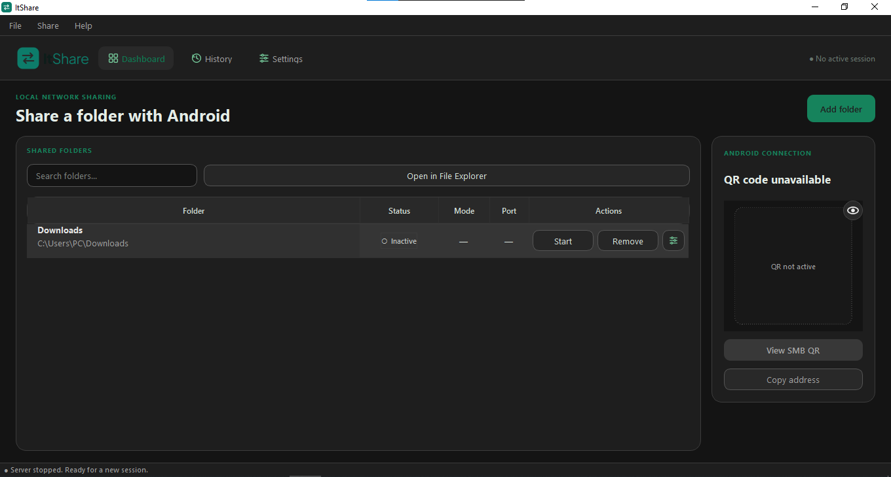
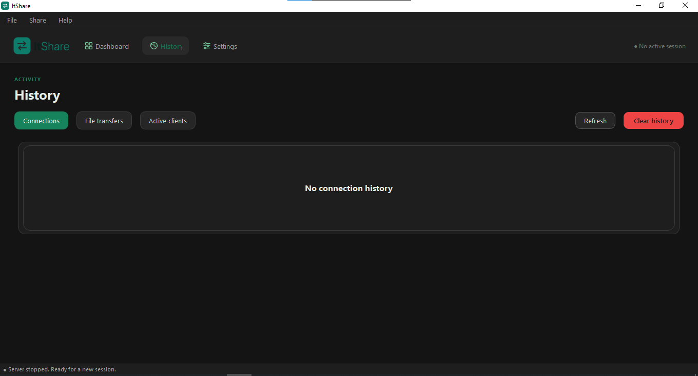
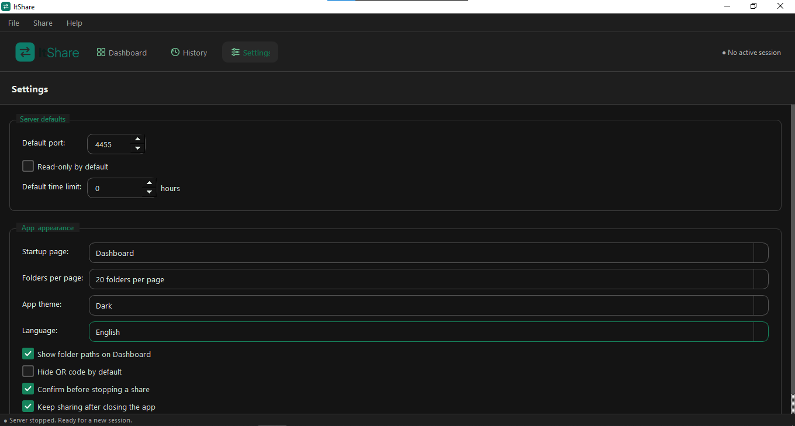

# ItShare PC

[](https://github.com/okkysatria/ItShare-pc/releases/latest/download/ItShare.exe)

ItShare PC is a Windows desktop app for sharing one or more folders over SMB on a local network. It creates session credentials and displays a QR code with the connection details, so another device can connect without uploading files to a cloud service. The companion Android client is available at [ItShare Android](https://github.com/okkysatria/ItShare-Android).

## Screenshots

### Dashboard



### History



### Settings



## Features

### Dashboard and folder sharing

- Add folders to the dashboard, search the list, open a folder in File Explorer, and start, stop, configure, or remove a share.
- Share multiple folders from one SMB server. Each folder has its own share name, access mode, and optional session duration.
- Show the SMB QR code or copy the connection address for a client device. The QR panel is unavailable until a share is active.
- Create a Wi-Fi QR code to help a device join the local network.

### History

- Review connection sessions, file transfers, and currently active clients.
- Refresh the activity views or clear connection and transfer history.

### Settings

- Set the default SMB port, read-only access, and session time limit for new shares.
- Choose the startup page and number of folders shown per page.
- Choose English or Indonesian, light/dark/system theme, and whether folder paths and QR codes are shown by default.
- Choose whether ItShare confirms before stopping a share and keeps sharing after the app closes. Keeping shares active is enabled by default; the app can restore them when reopened.
- Remember recent folders and folder aliases, and import or export a backup of folders and filtered settings.

## Project structure

```text
ItShare-pc/
├── assets/              # Application icons and branding
├── core/                # SMB service, sessions, network, QR, credentials, and local data
├── docs/screenshots/    # Application screenshots
├── tests/               # Automated tests
├── ui/                  # Main window, pages, dialogs, themes, and translations
├── main.py              # Desktop and detached SMB service entry point
├── pytest.ini
└── requirements.txt
```

## Technology and requirements

- Python 3.10 or later to run from source
- PySide6 for the desktop interface
- Impacket for the SMB server
- `qrcode` and Pillow for QR code generation
- Windows 10 or 11 (64-bit)
- A local network where the PC and client device can reach each other

The SMB server listens on TCP port `4455` by default. Windows Defender Firewall may ask to allow access; allow it on the **Private** network profile. Router settings, firewalls, or Wi-Fi client isolation can prevent devices from reaching one another. Do not forward the SMB port to the internet.

ItShare keeps local data in `%USERPROFILE%\.itshare`:

- `config.json` stores recent folders, aliases, connection history, and settings. Connection history does not include passwords.
- `active_share.json` stores the state needed to restore running shares and includes active session credentials.
- `transfer_history.jsonl` records transfer direction, time, client address, file path, and size; it does not include credentials.

The in-app backup contains recent folders and filtered settings. It excludes active credentials and transfer history.

## Run from source

Clone the repository, create a virtual environment, install dependencies, and launch ItShare:

```powershell
git clone https://github.com/okkysatria/ItShare-pc.git
cd ItShare-pc
python -m venv .venv
.\.venv\Scripts\Activate.ps1
python -m pip install -r requirements.txt
python main.py
```

If PowerShell blocks environment activation, use `.venv\Scripts\python.exe` to run Python and pip directly.

## QR connection format

The SMB QR code contains a version 1 JSON object:

```json
{
  "v": 1,
  "host": "192.168.1.50",
  "port": 4455,
  "share": "Documents",
  "user": "u9a1f2c",
  "pass": "session-password",
  "ro": true,
  "exp": 0
}
```

`host` is the selected IPv4 address; `share` is the SMB share name; `user` and `pass` are the active server credentials; `ro` is `true` for read-only access; and `exp` is the Unix expiration time in seconds, or `0` for a session without an expiration. Shares running together use the same server port and credentials, but each share has its own name, access mode, and duration. Treat the QR code as a credential and stop or regenerate the share if it is exposed.

## Development and tests

Install dependencies from [`requirements.txt`](requirements.txt). Run the test suite with:

```powershell
pytest -q
```
